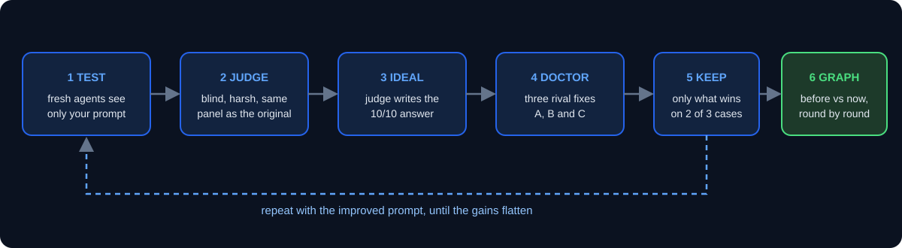

<div align="center">


<br>

**Make any prompt, writer or agent measurably better, and see the proof on a graph.**

<br>

<kbd>Claude Code skill</kbd> &nbsp; <kbd>blind judges</kbd> &nbsp; <kbd>prompt doctor</kbd> &nbsp; <kbd>live graph report</kbd>

</div>

<br>

## What it does

You tell it what to improve. It trains the prompt the way AI is trained: try it, score it without knowing which answer is which, find what the best answer has that yours lacks, fix the prompt, and run it again. Every round goes into a scoreboard, and the finished run ends with a graph page of the whole climb.

<div align="center">

</div>

<br>

## What you get

<table>
<tr>
<td width="50%" valign="top">

**During the run**

- A question first: *what do you want to improve?*
- A blind test rig: fresh agents that see only your real prompt
- Harsh judges that never know which answer is the original
- A scoreboard table after every round
- Small batches, Sonnet at medium effort, so you do not hit usage limits

</td>
<td width="50%" valign="top">

**At the end**

- Before vs now, per item, from the same judging panel
- Gain over the original, version by version
- Round-by-round charts for every item
- The doctor test: fixes A, B, C, combined, and the judge's ideal
- The full table and an honest note about noise

</td>
</tr>
</table>

<br>

## Install

```bash
git clone https://github.com/inventabotnow/self-training-loop-skill ~/.claude/skills/self-training-loop
```

Then, in Claude Code, say **"self-training loop"** or ask it to improve a prompt. It opens with one question:

> **What do you want to improve?**

<br>

## The trick that makes it work

Scores only tell you *that* an answer is weak. The loop asks the judge to write the **ideal 10/10 answer**, then compares it with what your prompt produced. The gap shows exactly which instruction was missing, weak or misleading. A *prompt doctor* turns that into three rival fixes, and only the fixes that win on at least two of three test cases are kept.

<details>
<summary><b>What building this taught us (click to open)</b></summary>

<br>

- **Tips written as a checklist backfire.** Writers tick boxes and repeat the same stock lines.
- **Example lines inside prompts get copied word for word.** Replace them with pattern descriptions.
- **"Skip the obvious first idea" works best as a required step**, not an optional tip.
- **Never compare scores from different judges.** The original prompt is re-scored in every panel.
- **One sample moves by about ±5 points.** Trust averages and big jumps only.
- **A rule for one goal has side effects.** A line meant to sharpen scripts made them too short; a word-count check caught it.
- **A prompt is a general recipe and the ideal is one specific idea.** Expect the best prompt to land a few points below the ideal.
- **After the prompt plateaus, search beats more rules:** generate several candidates and let a critic pick the best.

</details>

<br>

## Results from the project it was built on

Blind judges, same panel for the original and the new version:

| Writer | Original | After the loop | Scale |
|---|---|---|---|
| UGC script | 31.5 | **41** | out of 60 |
| Value video | 32 | **39** | out of 60 |
| Carousel | 37 | **41.5** | out of 60 |
| Ad concept (POV, demo, desired outcome) | 39.5 | **43.9** | out of 60 |
| News-format ad | 13 | **20-24** | out of 50 |

These are scores from AI judges reading text, not real views. Results will differ on your project.

<br>

## Files

| File | What it is |
|---|---|
| `SKILL.md` | The full method, the templates for writers, judges and the doctor, and the lessons above |
| `report-template.html` | The end-of-run graph page. Edit only the `REPORT` data block |
| `apply_candidates.py` | Applies the doctor's find-and-replace fixes and flags any that do not match |
| `banner.svg`, `loop.svg` | The images in this README |

<br>

<div align="center">
<sub>Built in one long session with Claude Code.</sub>
</div>
